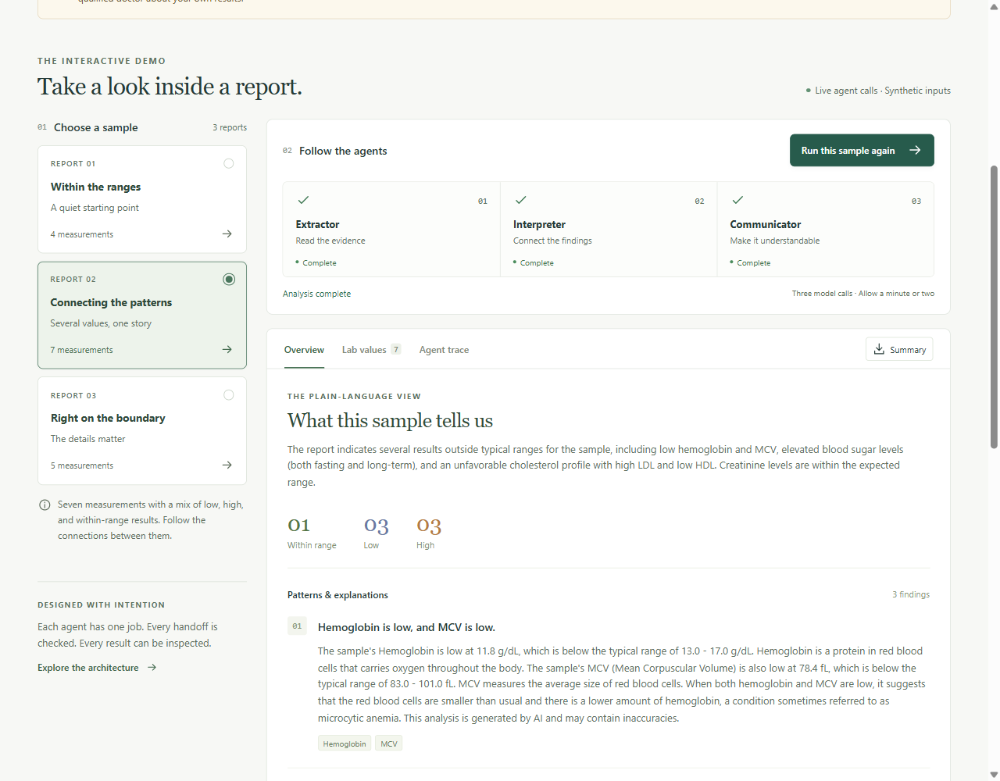
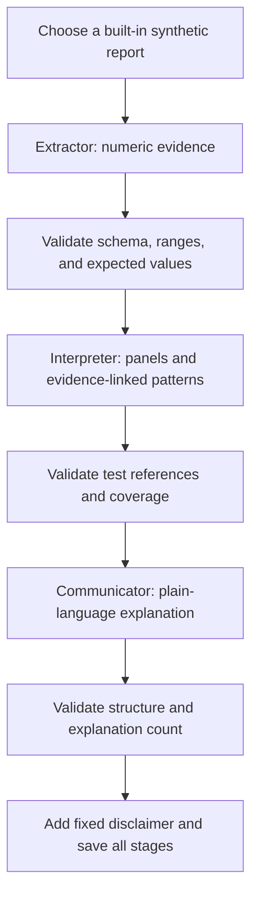

> **Public web demo:** the React interface displays recorded outputs from three real Gemini runs on synthetic reports. It makes no live AI calls. The Python pipeline and FastAPI adapter remain available separately. Netlify builds `frontend/` with the root `netlify.toml` configuration.

# MedReport Summarizer

**A three-agent LLM pipeline that turns synthetic blood-report data into an inspectable, plain-language explanation.**

**PORTFOLIO DEMO — FOR INFORMATIONAL PURPOSES ONLY.** This project uses built-in synthetic reports. AI-generated explanations can make mistakes. This is not a medical tool and must not be used for diagnosis, treatment, or decisions about seeking care. Consult a qualified doctor about your own results.

## What this project demonstrates

The interesting part is the handoff between agents: each stage has a different responsibility, a structured output contract, and checks before the next stage starts. The Python pipeline makes three real Gemini calls. The public React demo displays saved outputs from those calls, including the original report, extracted lab values, and each agent's input and output. It does not run live inference.

This is a **sequential multi-agent LLM pipeline**, not an autonomous agent system. It does not independently plan tasks, select tools, or establish medical accuracy.

**Live demo:** [MedReport Decoder](https://medreport-decoder.netlify.app/) — a static recorded demo hosted on Netlify. The Python pipeline and FastAPI API remain available for local live runs.



[Mobile screenshot](docs/screenshots/mobile.png)

## Start the web app

After the Python setup below, use Node 20.11.1 and the pinned Vite 5 toolchain:

```powershell
Set-Location frontend
npm ci
npm run build
Set-Location ..
.\.venv\Scripts\python.exe -m uvicorn api:app --host 127.0.0.1 --port 8000
```

Open http://127.0.0.1:8000. Choose a synthetic sample and select **Explore this report**.
Inspect Overview, Lab values, and Agent trace, then download Markdown or all-stage JSON.
No uploads are accepted. The React demo loads recorded outputs and needs no API key; live inference is available through the Python CLI or FastAPI endpoints.

For development, run the API in one terminal and `npm run dev` from `frontend/` in another.
Vite serves port 5173 and proxies `/api` to port 8000. No permissive CORS configuration is needed.

### Web API and run lifecycle

| Endpoint | Purpose |
| --- | --- |
| `GET /api/health` | Check server availability |
| `GET /api/samples` | List the three synthetic sources |
| `POST /api/runs` | Start a run with only `sample_id`; returns HTTP 202 and an ID |
| `GET /api/runs/{id}` | Read actual stage progress, errors, or the completed result |

The browser polls every 800 ms after the previous response finishes. If the connection breaks,
**Reconnect to this run** resumes checking the same job instead of starting new model calls.
Changing samples clears the old result. Generated text is rendered as text, never raw HTML.

Use **one Uvicorn worker**. This local milestone keeps at most 20 runs in memory; completed
runs expire after 30 minutes, and restarting the server clears them. Only one analysis runs
at a time; extra requests receive HTTP 409. Refreshing the page clears browser state, but does
not cancel an already-running server job. Public hosting, rate limits, and durable job handling
will be considered in the next milestone.

## How it works



| Agent | Input | Output | Application checks |
| --- | --- | --- | --- |
| Extractor | Synthetic report text | Test names, numbers, units, ranges, statuses, warnings | Strict types; finite numbers; exact bounds; no duplicate tests; match the authored sample |
| Interpreter | Validated extraction | Panels, findings, related test names, limitations | Every test belongs to exactly one panel; references must exist; every low/high result is cited |
| Communicator | Extraction and analysis | Plain-language summary, explanations, limitations | Required fields and one explanation entry per finding; fixed notice added by code |

The Interpreter describes the sample's evidence and relationships. It does not assign urgency, prescribe treatment, or recommend appointment timing. Those behaviors from the original CLI were removed for the portfolio scope.

## Built-in reports

| Sample ID | Tests | Purpose |
| --- | ---: | --- |
| `within-range` | 4 | Results inside the illustrative ranges |
| `mixed-patterns` | 7 | Multiple low/high values and cross-test relationships |
| `range-boundaries` | 5 | Strict `<` / `>` boundaries, inclusive boundaries, and a missing range |

Reports contain no patient identifiers. Their values and reference ranges are fictional educational examples. Each text file has an adjacent `.expected.json` file with the expected extraction.

These expected files are **checks, not canned agent responses**. Only report text goes to the Extractor. If its response changes or omits a value, the pipeline stops before interpretation. Analyses and explanations remain model-generated and can still be wrong.

Arbitrary text files, PDFs, and uploads are deliberately unsupported. The earlier `python main.py report.pdf` command is replaced by sample selection.

## Run locally (Windows PowerShell)

Use Python 3.10 and a project virtual environment:

```powershell
python -m venv .venv
.\.venv\Scripts\python.exe -m pip install -r requirements-dev.txt
Copy-Item .env.example .env
```

Edit `.env` locally and supply your Gemini API key. Never commit it:

```dotenv
GEMINI_API_KEY=your-key-here
GEMINI_MODEL=gemini-2.5-flash
```

The model is configurable because availability and quotas can change. An API key with access to the configured model is required. Live runs can consume quota or incur charges under your account settings.

List the samples without making an API call, then run one:

```powershell
.\.venv\Scripts\python.exe main.py --list
.\.venv\Scripts\python.exe main.py --sample mixed-patterns
```

Example progress:

```text
Extractor: started
Extractor: completed
Interpreter: started
Interpreter: completed
Communicator: started
Communicator: completed
Saved 7 tests and all three agent outputs to outputs\mixed-patterns-<unique-id>.json
```

Each JSON result contains `sample_id`, `model`, `extraction`, `analysis`, `explanation`, and `summary_markdown`. The pipeline itself writes no files; the CLI owns output saving. Files go under the current working directory's ignored `outputs/` folder by default.

To choose a filename:

```powershell
.\.venv\Scripts\python.exe main.py --sample range-boundaries --output outputs\boundary-demo.json
```

Existing files are never overwritten. A failed stage exits with code 1 and identifies the failure. Invalid CLI options exit with code 2. Failed stages do not produce a success file. No automatic retry hides a failure or unexpectedly adds model calls.

## Verification

```powershell
.\.venv\Scripts\python.exe -m pytest -q
.\.venv\Scripts\python.exe -m pip check
git check-ignore .env
```

In a restricted Windows sandbox, place disposable test files in the workspace:

```powershell
.\.venv\Scripts\python.exe -m pytest -q --basetemp=outputs\pytest-temp
```

Pytest clears the specified temporary directory; use it only for disposable test data.

Offline tests use scripted model responses and require no API key. They test contracts, missing/altered evidence, invalid references, skipped findings, API/network failures, stage ordering, and file-saving behavior. They do **not** evaluate model reasoning or medical correctness. Live smoke testing is separate: run each sample with the CLI and inspect its saved result.

See [VERIFICATION.md](VERIFICATION.md) for the milestone's actual test results and live-service limitations.

## Design decisions and limits

- **Three focused calls:** intermediate results are inspectable, but extra calls add latency and cost. There is no measured claim that this outperforms a single prompt yet.
- **Validation at every handoff:** schemas catch structural errors; authored fixtures verify extraction for these three samples. They cannot prove that generated prose is factually correct.
- **Provider schema versus local schema:** Gemini receives a simplified JSON Schema without length/count limits; the full Pydantic contract still validates its response locally.
- **Explicit failure handling:** each Gemini request has a 60-second timeout. Blocked, truncated, empty, invalid, or unsuccessful responses stop the pipeline with a safe message.
- **No clinical triage:** explanations are educational and synthetic. Prompt instructions and a disclaimer are not guarantees of model behavior.
- **No patient storage:** there are no real uploads or patient records. Generated synthetic outputs stay local and are gitignored.
- **Future web rendering:** model-generated text must be rendered safely; do not enable raw HTML when displaying Markdown.

## Repository map

```text
agents/             Three specialized agent functions and stage errors
api.py              FastAPI endpoints and bounded in-memory run management
frontend/           React interface, Vite configuration, and locked dependencies
samples/            Synthetic reports and expected extraction fixtures
tests/              Offline contract, pipeline, provider, and CLI tests
schemas.py          Typed data contracts and fixed disclaimer
llm.py              Gemini adapter and provider error handling
samples.py          Sample allowlist and extraction verification
pipeline.py         Reusable orchestration and progress events
main.py             CLI and output saving
AGENTS.md           Development guidance and bug log
```

Hosting and a single-prompt comparison are future work. See [WEB_VERIFICATION.md](WEB_VERIFICATION.md) for milestone-two checks.
